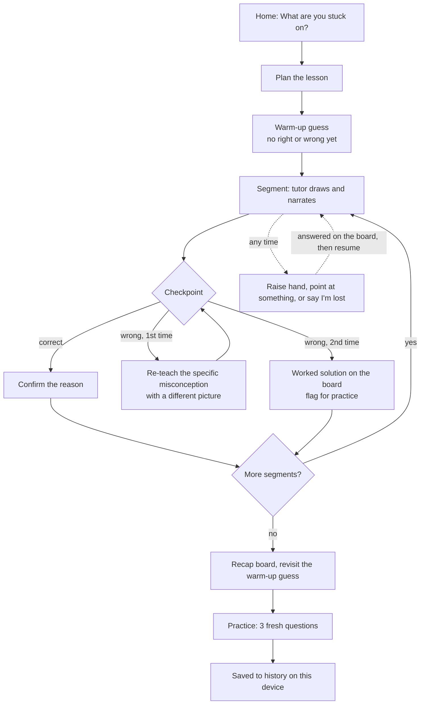

# Whyboard — Functional Requirements Document (FRD)

| | |
|---|---|
| **Product** | Whyboard (working title) — an AI tutor at a whiteboard for school maths |
| **Companion docs** | [PRD](01-prd.md) (why and for whom) · [Technical blueprint](03-technical-blueprint.md) (how, and the decisions behind it) |
| **Status** | Draft for review, 2026-11-16. Nothing here is built yet. |

This document says **what the product does**, precisely enough to build and test against. It does not say how; that is the blueprint's job.

## 1. Conventions

**Priorities**

| Tag | Meaning |
|---|---|
| **P0** | Required for the submission. The product is not coherent without it. |
| **P1** | Designed for now, built if time allows. The architecture must not block it. |
| **P2** | Deliberately deferred. Listed so that the omission is a decision, not an oversight. |

**Vocabulary**

| Term | Meaning |
|---|---|
| **Lesson** | One topic, taught in 3–5 segments, lasting roughly 6–10 minutes. |
| **Segment** | One idea: a short stretch of teaching that ends in a checkpoint. Each segment gets a fresh board page. |
| **Beat** | One spoken sentence plus the one to three board actions that sentence refers to. The unit of pacing. |
| **Board action** | A single semantic instruction from the tutor, such as "write this line", "plot this function", "circle that point". |
| **Checkpoint** | A moment where the tutor stops and the learner must do something before the lesson continues. |
| **Interrupt** | The learner stopping the tutor: a question, or "I'm lost". |
| **AI source** | Where model output comes from: *Recorded*, *My API key*, *Claude Code subscription*, or *Codex subscription*. |
| **Live** | Model output generated now, for this learner. |
| **Recorded** | Real model output captured earlier and replayed unedited. Never presented as live. |

## 2. Actors

| Actor | Who | What they need |
|---|---|---|
| **Learner** | A 14–18 year old stuck on a maths concept, studying alone. | To get unstuck and know they understood. |
| **Reviewer** | A Braynix evaluator opening the public demo with no key and a few minutes. | To explore the full experience immediately, and to see clearly what is live. |
| **Owner** | The developer running the app on their own machine. | To generate live lessons through their own Claude Code or Codex subscription, and to capture recordings for the public demo. |

## 3. The lesson, end to end

## 4. Functional requirements

### A. Starting a lesson

| ID | Requirement | Pri | Acceptance |
|---|---|---|---|
| A1 | The home screen shows a one-line promise, a topic box ("What are you stuck on?"), at least three starter lessons, and the current AI source. | P0 | A first-time visitor can start a lesson in one click with no setup. |
| A2 | The learner can type any topic (up to 300 characters) and optionally say where exactly they are stuck. | P0 | In a live source, submitting starts planning. In *Recorded*, the box is disabled with a one-line reason and a link to AI source settings. It never pretends to accept free text. |
| A3 | The planner sorts the topic into: **in scope** (school algebra, functions, graphs, early calculus), **adjacent** (other maths or science), or **declined** (not educational, or unsafe). | P0 | In scope: lesson starts. Declined: a kind one-line refusal with two suggested topics. |
| A4 | Adjacent topics run in **best-effort mode** with a persistent banner: "Outside my checked zone. I can explain and sketch, but I can't verify this the way I verify maths." | P1 | Banner is visible for the whole lesson and repeated in the recap. |
| A5 | Optional level chip: *Foundation / Standard / Stretch*. Changes vocabulary, step size and examples. | P1 | The same topic at two levels produces visibly different plans. |

### B. Planning and adapting

| ID | Requirement | Pri | Acceptance |
|---|---|---|---|
| B1 | A plan has: an objective in learner language, 3–5 segments, and for each segment a goal, the representation to use (graph, worked example, table, number line, analogy), the misconception it targets, and the kind of checkpoint. | P0 | The plan appears as a progress rail within the planning budget (§7). |
| B2 | Every lesson opens with a **warm-up guess**: one prediction question asked before any teaching. It is not marked right or wrong at the time. | P0 | The guess is stored and explicitly revisited in the recap ("Earlier you guessed… what do you think now?"). |
| B3 | Segments are written one at a time, each informed by what the learner has done so far: answers, misconceptions seen, questions asked, pace. | P0 | After a wrong answer in segment 1, segment 2 refers back to that difficulty at least once. |
| B4 | The tutor can change the plan: insert a prerequisite mini-segment when a question reveals a gap, or offer to skip ahead after a first-try streak. | P1 | An inserted segment appears in the progress rail, labelled as added. |
| B5 | A lesson never exceeds five planned segments plus two inserted ones. | P0 | Enforced by the app, not left to the model. |

### C. The board and playback

| ID | Requirement | Pri | Acceptance |
|---|---|---|---|
| C1 | The board draws each action as it is taught: handwritten lines, typeset equations, plots (axes first, then the curve traced left to right), points and labels, and marks (circle, underline, arrow, box) attached to existing elements. | P0 | Nothing appears on the board before the sentence that introduces it. |
| C2 | Layout is automatic. Elements never overlap or leave the board. A page has a fixed budget; when it is full, the tutor moves to a clean page. | P0 | Holds for every recorded lesson at 360, 768 and 1440 px widths. |
| C3 | Playback controls: play/pause, replay this step, back and forward one beat, speed (0.75×, 1×, 1.25×, 1.5×). | P0 | All reachable by keyboard: `Space`, `←`, `→`, `R`, `M` (mute), `/` (raise hand). |
| C4 | The progress rail lets the learner jump back to any completed segment to review its board and narration. Going forward past an unanswered checkpoint requires an explicit **Skip**. | P0 | Skipped checkpoints are recorded and resurface in practice. |
| C5 | Every board element can be focused, hovered and selected. Selecting one offers **Ask about this**. | P0 | Works by mouse, touch and keyboard (`Tab` cycles elements in reading order). |
| C6 | Learner pen: freehand ink on a layer above the tutor's work, erasable. Ink drawn around an element attaches that element to the next question. | P1 | Circling a point then asking "why here?" sends that point as context. No image is sent to the model. |
| C7 | Responsive: board beside the side panel at ≥1024 px; stacked below that; usable at 360 px. | P0 | No horizontal scrolling at any supported width. |
| C8 | Export the lesson's boards as an image or printable notes. | P1 | Output includes the "AI-generated" disclosure line. |
| C9 | With reduced motion requested, elements fade in instead of being drawn, and nothing moves continuously. | P0 | Verified with `prefers-reduced-motion: reduce`. |

### D. Narration

| ID | Requirement | Pri | Acceptance |
|---|---|---|---|
| D1 | Every beat's sentence is shown as a one-line caption and added to a transcript panel (collapsed by default). Captions are on by default and can be hidden while voice is playing. Only the current sentence is shown, never a wall of text beside the board. | P0 | The whole lesson is followable with sound off. With voice on and captions hidden, nothing is lost. |
| D2 | Voice uses the device's built-in speech. It can be switched off, and its rate follows the speed control. | P0 | First speech happens only after a user action (browser requirement). |
| D3 | Where speech is unavailable or muted, pacing follows estimated reading time. Lesson content is identical. | P0 | Muting mid-sentence does not skip or repeat a beat. |
| D4 | The actions of a beat begin with their sentence and finish before the next sentence starts. | P0 | Checked on recorded lessons at all four speeds. |
| D5 | Voice picker (from installed voices). | P1 | Choice persists on the device. |
| D6 | Spoken questions (speech-to-text). | P2 | — |

### E. Checkpoints

| ID | Requirement | Pri | Acceptance |
|---|---|---|---|
| E1 | Checkpoint kinds: **choice** (single answer), **number**, **expression** (algebra typed in), **tap** (pick a point or element on a figure), **set** (move a slider until a condition holds). | P0 | At least three different kinds appear across the starter lessons. |
| E2 | The tutor waits. No timer. The learner can replay the segment first. **"I'm not sure"** is always offered and leads to a hint, not a penalty. | P0 | Choosing "I'm not sure" never reveals the answer directly. |
| E3 | Number, expression, tap and set answers are graded by the app, not by the model. Equivalent forms are accepted (`2(x+1)` and `2x+2`); numbers allow a stated tolerance. | P0 | Unit-tested against a table of equivalent and non-equivalent inputs. |
| E4 | Each wrong option in a choice checkpoint names the **misconception** a learner choosing it probably holds. Number and expression checkpoints list anticipated wrong answers with their misconceptions. | P0 | Every wrong choice maps to a distinct misconception. |
| E5 | **Feedback ladder.** Correct: the tutor confirms *why* in one sentence, then continues. First wrong: no answer reveal; the tutor re-teaches that specific misconception using a **different representation** from the original, then asks again. Second wrong: a worked solution is drawn step by step, and the idea is flagged for practice. | P0 | The re-teach never repeats the original explanation's wording or picture. |
| E6 | Checkpoints never trap the learner: **Skip** is always available. | P0 | Skips are shown honestly in the recap as "not attempted". |
| E7 | The answer key is confirmed by the app before the checkpoint is shown: exactly one correct choice, and machine-checkable keys are recomputed. A checkpoint that fails this is regenerated once, then replaced by a self-rating ("Did that make sense? Yes / Sort of / No"). | P0 | A fixture with a deliberately wrong key is caught and never displayed. |
| E8 | **Sketch** checkpoint: the learner draws their predicted curve; the app compares it to the true function by shape (increasing/decreasing, turning points, intercept signs). | P1 | Graded locally from the stroke's points. No image leaves the device. |

### F. Interrupting the tutor

| ID | Requirement | Pri | Acceptance |
|---|---|---|---|
| F1 | **Raise hand** is available at every moment of a lesson and pauses the tutor immediately. | P0 | Speech stops within 300 ms. |
| F2 | The learner types a question, optionally with a selected board element attached. | P0 | The question is answered with awareness of what is currently on the board. |
| F3 | The answer is taught **on the board**, drawn and narrated, in a visually distinct "answer ink" and a separate margin area. It may point at existing elements. It is short (about a minute at most). | P0 | An answer never rearranges or erases the lesson's own work. |
| F4 | After an answer: **"Did that clear it up?"** → *Yes, carry on* / *Not quite* / *Show me differently*. | P0 | *Carry on* resumes from the start of the interrupted beat. |
| F5 | **"I'm lost"** is one tap. The tutor re-explains the current segment a different way, rotating through: a concrete numeric example, a picture, an everyday analogy, smaller steps. | P0 | Pressing it twice in one segment gives two different approaches. |
| F6 | Each segment offers two or three suggested questions as chips. | P0 | In *Recorded*, these are exactly the questions that have recorded answers. |
| F7 | Requests for a bare answer ("just tell me the answer") are met with the next step and a question back, not the answer. Off-topic or unsafe questions are redirected kindly. | P1 | Covered by evaluation prompts in the blueprint's test plan. |
| F8 | The learner can say "too fast" or "too slow"; pace and step size adjust for the rest of the lesson. | P1 | Reflected in subsequent segments. |

### G. Exploring

| ID | Requirement | Pri | Acceptance |
|---|---|---|---|
| G1 | **Explore** figures: a plot with one or two sliders for parameters. The curve updates instantly, computed on the device. The tutor gives a noticing prompt, then asks a checkpoint about what was seen. | P0 | Sliders work by drag, touch and arrow keys. At least one starter lesson contains one. |
| G2 | Draggable point on a curve with live read-outs (coordinates, slope of the tangent or secant). | P1 | — |

### H. Recap, practice and coming back

| ID | Requirement | Pri | Acceptance |
|---|---|---|---|
| H1 | **Recap board:** three to five key ideas, each linking back to the board page where it was taught, plus the warm-up guess revisited. | P0 | Clicking an idea opens its page. |
| H2 | **Practice:** three fresh questions, weighted toward ideas that were missed or skipped. Graded like checkpoints. | P0 | Result is shown per idea as *solid* or *shaky*. No percentage score. |
| H3 | **Teach-back:** "Explain it to me in two sentences." The tutor replies with what is right, what is missing, and one question back. Live sources only. | P1 | Disabled, with a reason, in *Recorded*. |
| H4 | **History:** lessons are saved on the device. The learner can reopen one to review boards and transcript, and delete one or all. | P0 | Survives a browser restart. Delete is immediate and complete. |
| H5 | Spaced review ("two questions from yesterday's lesson"). | P2 | — |

### I. Trust

| ID | Requirement | Pri | Acceptance |
|---|---|---|---|
| I1 | **Computed, not drawn.** Curves, points on curves and slider behaviour come from evaluating expressions on the device. The model never supplies curve shapes or pixel positions. | P0 | A model-claimed point that is not on its curve is caught. |
| I2 | **Checked steps.** Equations and expressions that have a machine-readable form are verified by the app. Checked maths carries a small tick. Maths that could not be checked carries a visible "not checked" tag. | P0 | Categories checked are listed in the blueprint; everything else is tagged. |
| I3 | A step that **fails** verification is never shown as if it were fine: the tutor is asked to fix it once; if it still fails, the step is shown with a clear warning or the segment is regenerated. | P0 | A fixture with an injected algebra error is repaired or flagged, never shown clean. |
| I4 | **"Something looks wrong"** on any element triggers a recheck. If a mistake is found, the correction is drawn visibly (strike-through, then the fix) and the tutor says so plainly. | P0 | The original mistake stays visible, struck through. |
| I5 | A persistent disclosure line: "AI-generated lesson. Maths marked ✓ was checked by code." | P0 | Present on the lesson screen and on every export. |
| I6 | The tutor says when it is unsure rather than bluffing. | P0 | Covered by evaluation prompts. |

### J. AI source and transparency

| ID | Requirement | Pri | Acceptance |
|---|---|---|---|
| J1 | Settings offer four AI sources: **Recorded lessons**, **My API key**, **Claude Code subscription (this computer)**, **Codex subscription (this computer)**. | P0 | Exactly one is active at a time. |
| J2 | A **source badge** is visible on every screen, for example `RECORDED · claude-sonnet-5-5 · captured 16 Nov 2026`, `LIVE · Anthropic API · claude-sonnet-5-5`, `LIVE · Claude Code on this computer`. | P0 | The badge is never absent and never ambiguous. |
| J3 | **My API key:** choose a provider from a fixed list (Anthropic, OpenAI, Google Gemini, OpenRouter, Groq), paste a key, press **Test**. The key is held in memory only by default, so a refresh forgets it; "Keep until I close this tab" is opt-in; it is never written to permanent storage. **Forget key** removes it at once. The key is sent only to the chosen provider, directly from the browser. | P0 | Network inspection shows no request carrying the key to the app's own host. After closing the tab, no trace of the key remains on the device. |
| J3a | The key screen says how to get a key that costs nothing (Google's Gemini free tier needs no card) and recommends a short-lived or spend-capped key for trying the demo. | P0 | A reviewer with no key can be running a live lesson in a few minutes. |
| J3b | Connect OpenRouter by sign-in instead of pasting a key. | P1 | Yields a key the user owns and can revoke. |
| J4 | **Subscription sources** work only when the app runs on the user's own computer, driving that user's own installed and signed-in CLI. The app never asks for, reads or stores a subscription login. It reports, for each CLI: *not installed*, *installed but not signed in*, or *ready*. On the public demo they are shown as unavailable with run-locally instructions. | P0 | Each of the three states shows a specific next step. The public build contains no code path that can reach a subscription. |
| J4a | Codex does not stream its answer piece by piece, so a segment arrives whole. The app says so while waiting ("Codex sends each segment in one go, so this takes a little longer") instead of looking stuck. | P0 | Playback after arrival is identical to other sources. |
| J5 | **Recorded mode is honest.** Recorded branches work (wrong-answer re-teaching, suggested questions, practice). Anything needing a live model (free topic, free-text questions, teach-back) is disabled with a reason, not faked. Each recorded lesson shows its provenance: model, date, "unedited model output". | P0 | A reviewer can tell, for any on-screen behaviour, whether it is live, recorded, or computed by the app. |
| J6 | A sensible default model per source, with an advanced override. | P0 | Changing the model updates the badge. |
| J7 | Usage visibility: estimated tokens and cost per lesson for API keys; the subscription usage window for Claude Code when the CLI reports it. | P1 | — |
| J8 | The source can be changed between lessons. | P0 | Changing source mid-lesson is P1. |
| J9 | A "What is sent where" panel in plain language. | P0 | Lists, per source, what leaves the device and to whom. |

### K. Privacy

| ID | Requirement | Pri | Acceptance |
|---|---|---|---|
| K1 | No accounts. No server-side storage of anything a learner types or does. | P0 | The public demo has no database. |
| K2 | No analytics that capture learner text. | P0 | — |
| K3 | The topic box reminds the learner not to include personal details. | P0 | — |

### L. Accessibility

| ID | Requirement | Pri | Acceptance |
|---|---|---|---|
| L1 | Everything is operable by keyboard, with visible focus. | P0 | A full recorded lesson, including an explore figure and a tap checkpoint, completed without a pointer. |
| L2 | Every board element has a text alternative. Plots are described automatically ("Graph of y = x² − 4x + 3 from x = −1 to 5. Marked points: (1, 0), (3, 0), vertex (2, −1)."). | P0 | The transcript panel is a complete, linear, screen-reader-friendly version of the lesson. |
| L3 | Text and essential graphics meet WCAG AA contrast. Right and wrong are never signalled by colour alone. | P0 | — |
| L4 | Reduced motion is honoured (see C9). | P0 | — |
| L5 | A "clean text" toggle swaps the handwriting font for a plain sans-serif; text size is adjustable. | P1 | — |

### M. When things go wrong

| ID | Requirement | Pri | Acceptance |
|---|---|---|---|
| M1 | Malformed model output is dropped or repaired without the learner seeing it. If too much of a segment is unusable, it is regenerated once; after that, a plain message offers **Try again**. | P0 | A corrupted fixture stream produces either a valid segment or the message, never a broken board. |
| M2 | Provider failures are explained in plain words with a next step: invalid key, usage limit reached, offline, CLI not signed in, model busy. | P0 | Each maps to a distinct message. No raw error text is shown by default. |
| M3 | While waiting, the tutor shows a "thinking" state. The learner can cancel. | P0 | No frozen screen longer than the budget in §7 without an indicator. |
| M4 | Playback never stalls mid-sentence waiting for the model. | P0 | A beat starts only when all of its actions have arrived. |
| M5 | A lesson in progress survives a page refresh, resuming at the last completed beat. | P0 | — |

## 5. What the tutor can put on the board

The model speaks to the board through a small, fixed vocabulary. This is the functional view; the wire format is in the blueprint.

| Action | What the learner sees | Pri |
|---|---|---|
| **say** | A spoken sentence and its caption. Starts a beat. | P0 |
| **write** | A handwritten line, with inline maths allowed. | P0 |
| **math** | A displayed equation. Carries a machine-readable form when one exists, so it can be checked. | P0 |
| **step** | One line of working with its reason ("subtract 3 from both sides"). Checked against the line before. | P0 |
| **plot** | Axes and one or more functions, by formula. | P0 |
| **point / line / guide** | Things added to an existing plot later: a labelled point, a segment or tangent, a dashed vertical or horizontal guide. | P0 |
| **numberline** | A number line with marked values or intervals. | P0 |
| **table** | A small table of values. | P0 |
| **mark** | A circle, underline, arrow or box attached to an element that already exists, with an optional note. | P0 |
| **explore** | A plot with sliders (see G1). | P0 |
| **check** | A checkpoint (see E). Ends the segment. | P0 |
| **page** | Start a clean board. | P0 |
| **region** | A shaded area on a plot. | P1 |
| **diagram** | A labelled geometric figure (triangle, circle, angle) in its own coordinates. | P1 |

The model never specifies pixel positions, sizes, colours or fonts.

## 6. Lesson states

| State | The learner can | Leaves when |
|---|---|---|
| **Home** | Choose or type a topic; open settings or history. | A topic is submitted. |
| **Planning** | Cancel. | The plan arrives → *Warm-up*. |
| **Warm-up** | Answer the guess; skip. | Answered or skipped → *Teaching*. |
| **Teaching** | Pause, replay, step, change speed, select elements, raise hand, say "I'm lost". | The segment's checkpoint is reached → *Checkpoint*. |
| **Checkpoint** | Answer; "I'm not sure"; replay segment; skip; raise hand. | Correct, second wrong, or skip → next segment or *Recap*. First wrong → *Re-teach*. |
| **Re-teach** | Same as *Teaching*. | Ends → back to *Checkpoint*. |
| **Interrupt** (overlay) | Type a question; cancel. | "Carry on" → returns to the interrupted state and beat. |
| **Recap** | Open any idea's board page. | Continue → *Practice*. |
| **Practice** | Answer; skip. | Three questions done → *Done*. |
| **Done** | Teach-back (P1); start another lesson; export (P1). | — |
| **Problem** (overlay) | Try again; change AI source; go home. | Resolved → returns to the prior state. |

## 7. Non-functional requirements

Budgets marked † are grounded in a measurement taken on 2026-11-16 (blueprint, Appendix A). They are targets to verify during the build, not promises.

| Area | Requirement |
|---|---|
| **Responsiveness** | Topic submitted → warm-up question on screen: ≤ 6 s at the median on streaming sources†. First segment begins drawing before the learner has finished the warm-up in the typical case. |
| | Next segment is ready before the learner finishes the current checkpoint in at least 9 of 10 cases. |
| | Question submitted → first stroke of the answer: ≤ 5 s at the median on API sources; ≤ 7 s through a local CLI†. |
| | Recorded lessons: first stroke ≤ 1.5 s after clicking a starter lesson. |
| **Smoothness** | Drawing animations hold 60 fps on a mid-range laptop and stay usable on a mid-range phone. |
| **Output quality** | After repair, ≥ 98% of generated board actions are valid. ≥ 95% of segments pass verification without regeneration. Zero failed-verification steps shown without a flag. Measured by the evaluation harness. |
| **Browsers** | Current and previous major versions of Chrome, Edge, Safari and Firefox. Voice degrades to captions where speech is unreliable. |
| **Accessibility** | WCAG 2.2 AA for the application chrome; the board follows §L. |
| **Security** | No secrets in the repository or the deployed bundle. API keys are never sent to the app's own host. The local bridge is unreachable from other machines and other websites. Model output is treated as untrusted input. Detail in the blueprint. |
| **Privacy** | See §K. |
| **Cost** | A full lesson should cost roughly 10–15 US cents on a mid-tier model and under one cent on a small one, at list prices checked on 2026-11-16. The blueprint carries the working. |

## 8. Out of scope

| Not doing | Why |
|---|---|
| Accounts, sync across devices, teacher or parent dashboards | Adds a backend and personal data for no gain to the core loop. |
| Subjects beyond maths as a verified experience | The trust story depends on being able to check the work. Best-effort mode (A4) covers curiosity honestly. |
| Photo of homework as input | Useful, but a separate vision problem; and it pulls the product toward answer-getting. |
| Multi-user collaborative board | A different product. |
| Generated video or generated images | Slow, uncheckable, and not interactive. |
| Free-form infinite canvas editing | The board is a teaching surface, not a drawing tool. |
| Hindi and other languages | Valuable for the target learner; deferred to keep the first version finished (P2). |
| Grades, streaks, leaderboards | Reward activity rather than understanding. |

## 9. Acceptance scenarios

These double as the reviewer's guided tour and as end-to-end tests.

**S1 — Recorded lesson, no setup (public demo)**
*Given* a first-time visitor on the public demo, *when* they click a starter lesson, *then* within 1.5 s the warm-up question appears, the badge reads `RECORDED` with model and date, and after answering, the board begins drawing in step with captions.

**S2 — A wrong answer is treated as information**
*Given* a checkpoint, *when* the learner picks a wrong option, *then* the answer is not revealed; the tutor names the likely confusion in neutral words, re-teaches with a different picture, and asks again. *When* they are wrong a second time, *then* a worked solution is drawn and the idea later appears in practice.

**S3 — Pointing at the board**
*Given* a lesson in progress, *when* the learner selects the vertex on a plot and chooses a suggested question, *then* the tutor pauses, answers in answer ink referring to that point, asks whether it helped, and resumes at the interrupted beat.

**S4 — Live lesson with a pasted key**
*Given* a reviewer pastes a valid key and presses **Test**, *when* they type a topic of their own, *then* the badge reads `LIVE` with provider and model, a plan appears, and the lesson is generated for that topic. No request to the app's host contains the key.

**S5 — Live lesson through a local subscription**
*Given* the app running on the owner's computer with Claude Code signed in, *when* they select *Claude Code subscription*, *then* status reads *ready*, the badge reads `LIVE · Claude Code on this computer`, and a typed topic produces a lesson with no API key present anywhere.

**S6 — Explore, then explain**
*Given* an explore figure, *when* the learner moves the slider, *then* the curve updates instantly; the following checkpoint asks about what changed.

**S7 — A mistake is caught**
*Given* a test fixture containing an incorrect algebra step, *when* it is played, *then* the step is repaired or carries a visible warning. It is never shown with a tick.

**S8 — Failure is survivable**
*Given* a live lesson, *when* the key is revoked or the network drops mid-segment, *then* the current beat finishes, a plain message explains what happened, and the learner can retry or switch source without losing the lesson so far.

**S9 — Keyboard and silence**
*Given* voice off and no pointer, *when* a user completes a recorded lesson including an explore figure and a tap checkpoint, *then* every step is achievable and the transcript contains the whole lesson.

## 10. How the requirements map to the evaluation framework

| Evaluation dimension | Where it is addressed |
|---|---|
| Product understanding and problem framing | PRD §2–4; scope decisions in §8 here. |
| Originality and product thinking | Warm-up guess (B2), misconception-mapped checkpoints (E4–E5), pointing at the board (C5, F2–F3), honest recorded mode (J5). |
| Engineering and problem-solving | Automatic layout (C2), verification (E7, I1–I4), failure handling (M1–M5); blueprint decision log. |
| AI integration and application | Section J; adaptive segments (B3); trust rules (I). |
| Teaching and interaction quality | Sections B, D, E, F, G, H. |
| Code quality and technical decisions | Blueprint: contracts, repository structure, testing. |
| Documentation and communication | These three documents; README requirements in the blueprint. |
