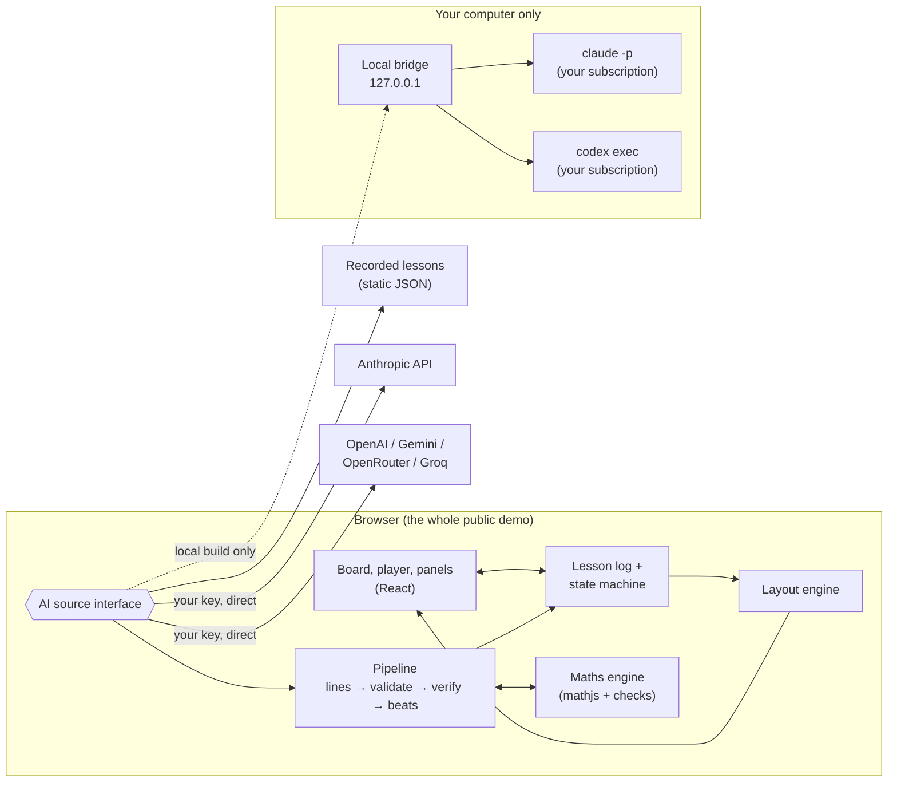
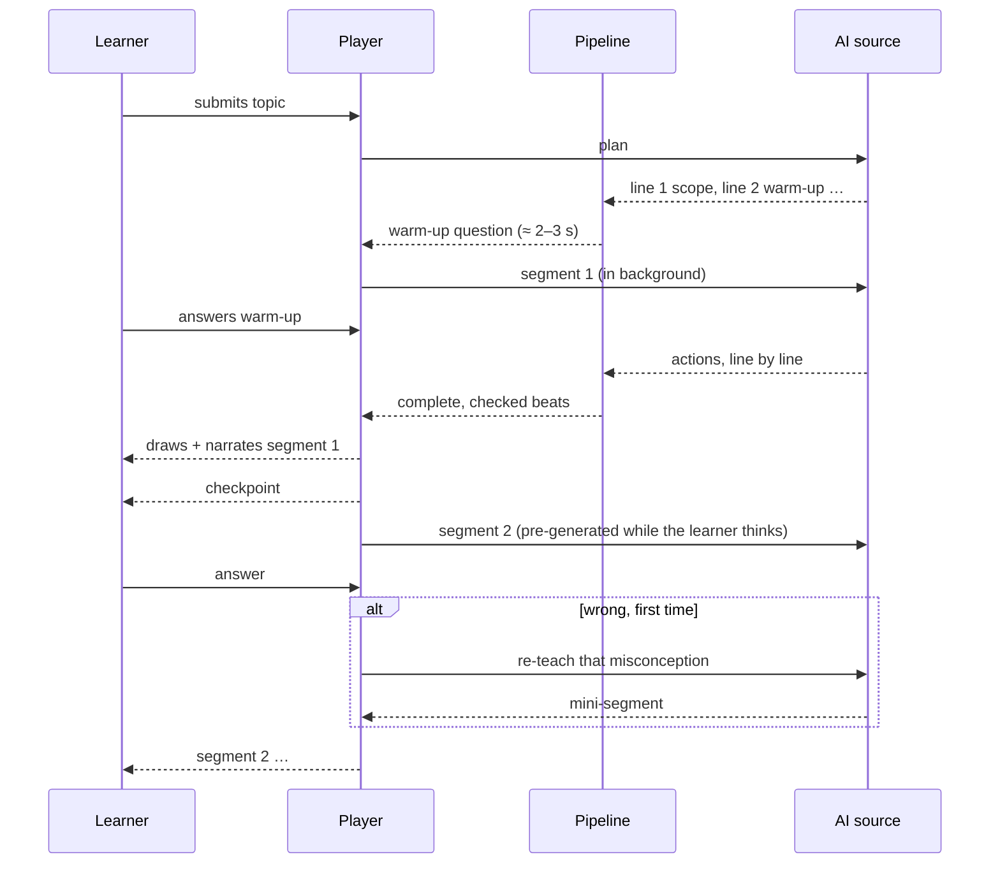

# Whyboard — Technical Blueprint

| | |
|---|---|
| **Product** | Whyboard (working title) — an AI tutor at a whiteboard for school maths |
| **Companion docs** | [PRD](01-prd.md) (why and for whom) · [FRD](02-frd.md) (what it does, testably) |
| **Status** | Draft for review, 2026-11-16. Nothing here is built yet. |

This document says how Whyboard is built and, above all, **why each choice was made and what was turned down**. Section 3 is the decision log.

Three kinds of evidence sit behind the decisions, and they are kept apart throughout:

- **Measured** — I ran it on this machine on 2026-11-16 ([Appendix A](#appendix-a-what-was-measured)).
- **Documented** — read from a primary source on that date. Not exercised.
- **Judgement** — my call, with the reasoning shown.

## 1. The idea in one paragraph

The language model is good at deciding *how to teach*: what to say next, which picture to use, which wrong answers are tempting. It is bad at three things a whiteboard needs: placing things in space, being reliably right about arithmetic, and keeping time. So the model's only job is to emit a stream of small, semantic **board actions** ("plot this function", "circle that point", "ask this"). Ordinary code does the rest: it validates each action, checks the maths, decides where everything goes, and plays it in step with narration.

> **The model decides pedagogy. Code owns truth, layout and time.**

Almost every decision below follows from that sentence.

## 2. Constraints that shaped the design

| Constraint | Consequence |
|---|---|
| The owner has **no paid API key**. | The public demo cannot depend on one. Live generation must work through a Claude Code or Codex subscription on the owner's machine. |
| Reviewers need a **public URL that works immediately**. | A no-setup mode that is real, not a mock-up. |
| The brief demands **honesty about live vs. simulated** behaviour. | Provenance is a first-class part of the data model, not a label added at the end. |
| The learner may be **a minor**. | No accounts, no server-side learner data, no analytics on what they type. |
| **Secrets must never leak.** | The public build has no server and holds no secrets, so there is nothing to leak. |
| The brief rewards **a small, finished product** over feature count. | One dependency per job; anything that needs a backend is cut. |

## 3. Decision log

Each entry gives what was decided, what else was considered, why, what it costs, and what would change my mind.

### D1. A generated lesson with compulsory checkpoints, not a chat with a canvas

**Decided.** The product is a structured lesson the tutor drives: plan, warm-up guess, segments that each end in a checkpoint, recap, unaided practice. The learner can interrupt at any time, but the default is that the tutor leads.

| Option | For | Against |
|---|---|---|
| Chat with a drawing canvas | Familiar; flexible | The learner must know what to ask. Nothing forces thinking. It is what every assistant already ships. |
| Generate an explainer video | Looks impressive | Passive, slow to render, not interactive. Generated animation code frequently runs but renders overlaps and broken continuity ([arXiv 2605.15585](https://arxiv.org/abs/2605.15585)). |
| Hand-authored lesson catalogue | Highest quality per lesson | Cannot address the learner's own stuck point; AI would be decoration. |
| **Structured, generated, interruptible lesson** | Forces doing; adapts; is checkable segment by segment | Less freedom for the learner; needs a planner |

**Why.** The strongest evidence on AI tutoring is that unrestricted help hurts exam performance and guardrails merely remove the harm ([Bastani et al., 2025](https://doi.org/10.1073/pnas.2422633122)). A structure that makes the learner act is the product's whole argument. Voice plus live drawing is now commonplace (PRD §7), so the loop has to be the differentiator.

**Costs.** A lesson format is less open-ended than a chat. **Revisit if** learners mostly want to bring a specific homework problem rather than a concept.

### D2. School algebra, functions and graphs only

**Decided.** The verified experience covers secondary-school algebra, functions, graphs and early calculus intuition. Other topics run in a clearly labelled best-effort mode (P1) or are declined.

**Why.** The domain is visual, its misconceptions are documented, and a program can check it. A tutor that covers everything can verify nothing. **Costs.** A reviewer who types "photosynthesis" gets a labelled, unverified lesson or a polite redirect. **Revisit if** a second checkable domain (mechanics, probability) earns its own verifier.

### D3. The model emits semantic actions; a layout engine places them

**Decided.** The model never produces coordinates, sizes, colours, SVG or drawing code. It produces actions that refer to things by ID (`{"t":"mark","kind":"circle","target":"v"}`). Inside a plot it uses *mathematical* coordinates, which it handles well. A deterministic layout engine turns actions into positions.

| Option | For | Against |
|---|---|---|
| Model emits pixel coordinates or shape records | Maximum freedom | Models are unreliable at spatial placement; overlap and overflow are the norm. tldraw, who build this for a living, report agents handle "this/here" badly and moved to anchoring on shapes ([tldraw, Aug 2026](https://tldraw.dev/blog/agents-cant-point)). |
| Model emits SVG or HTML | No renderer to build | Unverifiable, unsafe to inject, not addressable (nothing to point at), no animation semantics. |
| Model writes drawing code (Manim, canvas scripts) | Very expressive | Needs a sandbox and a render step; code that runs still renders wrongly; no interactivity. |
| **Semantic actions + deterministic layout** | Always legible; every element has an ID to point at, check and describe; replays are identical | The tutor can only draw what the vocabulary allows |

**Why.** Three product features depend on elements being *things* rather than pixels: pointing at an element to ask about it, attaching a verification result to a step, and generating a text alternative for a screen reader. The limited vocabulary is a feature in a teaching tool: it keeps boards consistent.

**Counter-evidence considered.** DiagrammerGPT reports usable model-produced bounding boxes after a refinement pass ([arXiv 2310.12128](https://arxiv.org/abs/2310.12128)). That adds a second model call per figure and still gives no guarantee, so it loses to a layout engine here.

**Costs.** New kinds of figure need code, not just a prompt. **Revisit if** the vocabulary proves too narrow in the evaluation run; the fix is to add an action, not to open up coordinates.

### D4. A custom SVG-and-HTML renderer, not tldraw or Excalidraw

**Decided.** The board is a React component with two aligned layers in one logical coordinate space: HTML for text and equations, SVG for figures and marks.

| Option | For | Against |
|---|---|---|
| **tldraw SDK** (v5.6) | Best-in-class canvas. Learner pen, pan and zoom come free. Real accessibility support (keyboard navigation between shapes, screen-reader descriptors, a stated WCAG 2.2 AA target). Freehand strokes can be scripted through [`@tldraw/driver`](https://tldraw.dev/docs/driver). An agent starter kit exists. | Source-available licence: production use needs a key, and without one the editor stops rendering after five seconds. The free hobby licence is by application, discretionary, with no stated turnaround, and adds a watermark ([licence](https://github.com/tldraw/tldraw/blob/main/LICENSE.md), [key behaviour](https://tldraw.dev/sdk-features/license-key), [hobby terms](https://tldraw.dev/get-a-license/hobby)). It is an editor: for tutor-authored content most of it would be switched off (read-only, locked camera), and every element would still be a custom shape that I write, on top of the same layout engine. |
| **Excalidraw** (0.18, MIT) | Open licence; hand-drawn look; scene API | No maths typesetting (issue open since 2022; a pull request is unmerged). No live draw-on animation in the editor. Its model is a free-form editor, which is the opposite of D3. |
| **Canvas** (Konva, PixiJS, plain 2D) | Fast | No DOM per element, so accessibility, text selection and equation overlays are all manual. Speed is not the problem at whiteboard element counts. |
| **Custom SVG + HTML** | Per-element events, focus and ARIA for free; CSS animation; full control of the draw-on effect; no licence risk | I write the renderer |

**Why.** Given D3, an editor is the wrong tool: Whyboard needs a *player* for a known vocabulary of about fifteen element types, not a general canvas. The renderer is a few hundred lines per element family, and the part that is genuinely hard (layout) I would have to write on top of either library anyway.

**Supporting pieces.** [rough.js](https://github.com/rough-stuff/rough) (MIT, ~9 kB) for sketchy axes, boxes and marks, with a fixed seed so replays render identically. It is stable but dormant (last release 2023), which is acceptable for a small, finished library. [perfect-freehand](https://github.com/steveruizok/perfect-freehand) (MIT, ~2 kB) for the learner's pen (P1).

**How sure this is.** It is a judgement about fit, not a verdict that tldraw is worse. tldraw is the better canvas; this product mostly needs a player. The choice is also contained: the renderer consumes the layout engine's output and lives in `src/board/`, so hosting the same elements as tldraw custom shapes later would not touch the pipeline, the verifier or the lesson logic.

**Costs.** No infinite canvas, no free-form editing, and the learner pen (P1) has to be built rather than inherited. **Revisit if** the learner writing their own working on the board becomes core rather than P1, or if collaboration becomes a goal. tldraw would then be the right base and its licence a cost worth paying. Applying for a hobby licence early is a cheap hedge.

### D5. KaTeX with a wipe reveal; a handwriting font for prose

**Decided.** Equations are typeset with KaTeX and revealed left to right by an animated clip. Prose uses Playpen Sans, self-hosted. A "clean text" toggle swaps in a plain sans-serif (P1).

| Option | For | Against |
|---|---|---|
| MathJax 4, SVG output, stroke each glyph | Equations appear to be *written* | ~615 kB gzipped against KaTeX's ~76 kB. The stroking technique is my inference, not a documented one. |
| Single-stroke fonts (Hershey, Vara.js, hfmath) | True pen strokes | All effectively abandoned since 2020–22; thin glyph coverage. |
| **KaTeX + wipe** | Small, fast, correct typesetting, real text for screen readers | Reveals rather than "writes" |

**Why.** The evidence for watching drawing happen depends on a visible human hand ([Fiorella & Mayer, 2016](https://doi.org/10.1037/edu0000065)), so there is no learning-science case for spending 540 kB on glyph-stroking. What matters is that each piece appears *when it is spoken about*, which a wipe achieves. Playpen Sans is the one open handwriting font I found that ships Greek and maths subsets (OFL).

**Costs.** Equations look typeset, not handwritten. I think that is right for legibility. **Revisit if** user testing says the mixed look is jarring.

### D6. A small plotter of my own

**Decided.** Plots are an SVG component that samples compiled expressions. Curves are drawn precisely; only axes and marks are sketchy.

| Option | Why not |
|---|---|
| [Mafs](https://mafs.dev) (MIT, ~95 kB) | The closest fit, and the fallback. But I need trace-on animation, marks anchored to plot features, per-feature hit-testing and IDs, and Mafs pins an older KaTeX. |
| function-plot, JSXGraph | Not React-native; own interaction model; same anchoring problem. |
| Desmos API | Proprietary, key required, demo key being withdrawn. |

**Why.** Plotting `y = f(x)` with axes, ticks, discontinuity handling and labelled points is roughly 300 lines, and every one of them needs to cooperate with the layout engine, the verifier and the animation clock. **Costs.** No implicit curves, inequalities or 3D. **Revisit if** the vocabulary grows toward a general graphing tool.

### D7. Maths is checked by code, using one library and numeric methods

**Decided.** [mathjs](https://mathjs.org) (Apache-2.0, ~197 kB gzipped, lazy-loaded) parses and evaluates expressions. Equivalence is decided by **sampling**: evaluate both sides at random points and compare. Roots are found numerically. No symbolic algebra system in the first version.

| Option | For | Against |
|---|---|---|
| Trust the model | Free | Only 57% of LLM tutoring dialogues were correct throughout in one study ([Gupta et al., 2025](https://arxiv.org/abs/2503.16460)). |
| Ask a second model call to check | Catches some errors | Same failure mode, doubled cost; no guarantee. |
| Symbolic equality (`mathjs.symbolicEqual`, nerdamer, Compute Engine) | Exact when it works | mathjs's own docs say a `false` "does not absolutely rule this out". nerdamer 2.0 is a breaking rewrite; Compute Engine is pre-1.0 and large. |
| SymPy in the browser via Pyodide | A real CAS | ~10 MB transfer and a multi-second cold start. |
| **Numeric sampling + root-finding** | A counterexample is a *proof* of error. Simple, fast, one dependency, easy to test. | Equivalence is "no counterexample in N samples", not proof. Bounded to real, single-variable, school-level expressions. |

**Why.** The verifier's job is to *catch mistakes*. Sampling is asymmetric in exactly the right direction: when it says "wrong", it holds a concrete number that shows why, which also makes a good repair prompt. False "equal" verdicts need two different expressions to agree at eight random points, which does not happen for school algebra outside deliberately adversarial cases.

**What is checked** is specified in §6. **Costs.** No symbolic solving; anything without a machine-readable form is tagged "not checked" rather than verified. **Revisit if** the unchecked share is high in the evaluation run; then lazy-load nerdamer-prime for solving.

### D8. One JSON object per line, validated per line

**Decided.** Every model response is JSONL: one small action per line, no surrounding prose. The app splits on newlines, parses, and validates each line against a Zod schema. Invalid lines are dropped or repaired individually.

| Option | For | Against |
|---|---|---|
| Provider structured outputs / strict tool calls | Schema guaranteed by the provider | Three different APIs with different schema limits (no recursion, required-everything, ignored keywords). Not available through `claude -p` streaming or Groq streaming. Partial output is not validated anyway. |
| One big JSON document | Simple to describe | Cannot draw anything until the closing brace, or needs a partial-JSON parser. One bad field spoils the lot. |
| **JSONL + per-line validation** | Works identically across all five sources. Each line is usable the moment it ends. One bad line costs one action. | No schema guarantee; needs a skip-or-repair policy |

**Why.** Five very different transports have to feed one pipeline (D11), and the only thing they share is "text arrives over time". JSONL makes the time-to-first-stroke the time to the first newline. **Measured:** on the realistic prompt in Appendix A, both models produced 100% valid lines (19 of 19 and 17 of 17) with no schema enforcement, and the first complete action arrived 2.6 s after launch.

**Known pitfalls and how they are handled.** Code fences and stray prose are stripped. Chunks that split a line or a multi-byte character are buffered with a streaming decoder. A final line cut off by the token limit is discarded. This is the same shape as the AI SDK's validated element stream, which is reassuring prior art.

**Costs.** I own validation and repair. **Revisit if** validity drops on weaker models; the stricter alternative is a schema-constrained `{"actions":[…]}` parsed incrementally on providers that support it.

### D9. Plan first, then write each segment just in time

**Decided.** One short call plans the lesson and writes the warm-up question. Segments are then generated one at a time. While the learner works on a checkpoint, the next segment is generated in the background.

| Option | For | Against |
|---|---|---|
| Generate the whole lesson in one call | One call; coherent | A long wait up front. Cannot adapt to anything the learner does. Wasteful when learners leave early. |
| Fully reactive, one beat per turn | Maximally adaptive | A model call between every sentence: slow, expensive, and loses the arc of a lesson. |
| **Plan, then segments on demand, pre-generated one ahead** | Fast start; each segment knows what just happened; cost follows actual use | A pre-generated segment is sometimes thrown away |

**Why.** **Measured:** a full 19-action segment took 9.5 s to generate on Sonnet, and plays for roughly a minute. Generation is therefore about six times faster than playback, so the buffer stays ahead of the learner, and the warm-up question (which arrives on the plan's second line) occupies the learner while segment 1 is written.

**Staleness rule.** A pre-generated segment is discarded and regenerated only if the learner fails the checkpoint twice or a question triggers a plan change. Re-teaching after a first wrong answer is an inserted mini-segment, so the pre-generated one stays valid.

**Costs.** Occasional wasted calls. **Revisit if** cost matters more than responsiveness; then generate on demand only.

### D10. The lesson is an append-only log; the screen is a function of it

**Decided.** Everything that happens (each validated action, each learner answer, each interrupt) is appended to a lesson log. An explicit state machine, written as a typed reducer, derives the current state. Speech, timers and model calls live in an effects layer outside the reducer.

**Why.** One mechanism yields four features: restoring after a refresh, lesson history, recorded lessons, and deterministic tests are all "replay the log". It also makes the trickiest behaviour, pausing mid-beat for a question and resuming exactly there, a matter of state rather than of timers.

**Options not taken.** State scattered across components (impossible to resume or test). XState (a good library, but a typed reducer covers eleven states without a new dependency or a new notation for reviewers to learn). Zustand holds the store.

**Costs.** Slightly more ceremony for simple interactions.

### D11. One source interface, five adapters, and keys that go straight from the browser to the provider

**Decided.** All model access goes through one interface. Five adapters implement it:

| Adapter | Reaches | Runs in |
|---|---|---|
| `replay` | Recorded lessons in the app bundle | Browser |
| `anthropic` | Anthropic Messages API | Browser, direct |
| `openai-compatible` | OpenAI, Google Gemini, OpenRouter, Groq (one wire format, fixed list of base URLs) | Browser, direct |
| `claude-code` | The user's own `claude` CLI | Local bridge |
| `codex` | The user's own `codex` CLI | Local bridge |

For pasted keys, the browser calls the provider directly. There is no proxy.

| Option | For | Against |
|---|---|---|
| Proxy keys through my server | Hides provider differences; allows rate limiting | The reviewer must trust my server with their key. I must run, secure and pay for a server. |
| **Browser-direct** | The key provably never touches my infrastructure: there is none. The public demo is static files. | The key is exposed to the page's own JavaScript, so the page must be trustworthy |

**Why.** **Documented, with preflight probes run:** Anthropic, OpenAI, Gemini, OpenRouter and Groq all answer cross-origin preflights. Anthropic needs the header `anthropic-dangerous-direct-browser-access: true`. Providers recommend a backend for production apps, and they are right for a product with its own users; this is the bring-your-own-key carve-out, for a reviewer's own short-lived key.

**Making that safe enough.** The key lives in memory only by default, with opt-in `sessionStorage` and never `localStorage` (OpenRouter's guidance is not to persist keys at all). A strict Content Security Policy limits `connect-src` to the five provider hosts and `script-src` to the app itself; no third-party scripts or fonts are loaded. Base URLs are a fixed list in the public build, so the policy can stay tight. The settings screen recommends a short-lived key (Anthropic's console offers 3-hour and 1-day expiry) or a free one (Gemini's free tier needs no card).

**Wire formats.** Two only: Anthropic Messages, and OpenAI-style Chat Completions, which Gemini, OpenRouter and Groq also speak. Both are called with `fetch` and a shared ~60-line server-sent-events reader rather than two SDKs, to keep the bundle small and the code path identical in tests. **Costs.** I track two wire formats by hand; Gemini's compatible endpoint is still labelled beta. **Not exercised:** a real streamed call from a browser, since I have no keys. That is the first thing to test in M2.

### D12. Subscriptions are reached by running the user's own CLI, locally, and nothing else

**Decided.** When the app runs on the user's own computer, a small local server spawns their already-installed, already-signed-in `claude` or `codex` binary for each request, with tools disabled, and streams the text back. The app never sees, asks for, or stores a login or token. This path does not exist in the public build.

| Option | For | Against |
|---|---|---|
| Claude Agent SDK | A typed API | Anthropic's wording singles out "agents built on the Claude Agent SDK" when it prohibits offering claude.ai login in a product. It also bundles its own binary. |
| Long-lived token (`claude setup-token`) on a server | Would make the hosted demo live | Routing other people's requests through one subscription is exactly what is prohibited. |
| Hosted page talks to a companion process on `localhost` | Public URL with live local AI | Chrome 142+ puts public-to-loopback requests behind a permission prompt; Safari has long-standing mixed-content blocks. Fragile, and a wider attack surface. |
| **Spawn the user's own unmodified CLI, on their machine** | Matches the permitted case as written. No credentials handled. | Local only. Process start-up on every call. Depends on CLI flags. |

**Why, on policy.** Anthropic's terms prohibit third parties from offering claude.ai login in their apps or routing requests through plan credentials on behalf of users, and say developers "may not collect, store, or intermediate" those credentials. The same page says this does not "prevent an end user from signing in to the unmodified Claude Code binary with their own Claude subscription", and that plan limits "assume ordinary, individual usage of Claude Code and the Agent SDK" ([source](https://code.claude.com/docs/en/legal-and-compliance)). A local tool that shells out to the user's own binary is on the permitted side of that line. That is my reading, not a ruling from Anthropic, and the README will say so. For Codex, OpenAI's docs say `codex exec` "reuses saved CLI authentication by default" but steer automation toward API keys; personal local use is not addressed either way. **For anyone else using this project, an API key remains the documented default.**

**Why, on mechanics. Measured** for Claude Code: with the flags in §7.3 the CLI behaves as a plain streaming model. It reported no tools, no MCP servers, no skills, `apiKeySource: "none"` (meaning the subscription was used), and a 634-token input for a trivial prompt, which shows that none of the user's own instructions, plugins or hooks leaked in. Process overhead was about 1.5–2.5 s per call on top of the model's own time. `claude auth status` returns JSON suitable for a preflight.

**Known limits.**

- **Codex does not stream text.** `codex exec --json` emits the answer as one completed item, so a segment arrives whole (**documented**, from the source). The interface copes: the adapter emits one large chunk and playback is unchanged, only the wait is longer, and the UI says so (FRD J4a). `codex app-server` does stream but is labelled experimental; it is the P1 upgrade.
- **The Codex adapter is untested.** Codex is not installed on this machine. The command in §7.3 is built from documentation and must be verified before it is advertised as working.
- **A CLI change can break this.** Anthropic's docs say `--bare` will become the default for `-p` in a future release, and bare mode does not read subscription logins. The preflight will detect this and say so plainly.
- **Plan limits apply.** Calls draw on the plan's five-hour and weekly limits. The CLI reports utilisation in its stream, which the app can show (FRD J7).

**Costs.** No public live demo through a subscription, by design. **Revisit if** either vendor publishes a sanctioned way for a local web app to use a plan.

### D13. The public demo replays real recordings through the real pipeline

**Decided.** The public demo opens in *Recorded* mode. A recording is the raw text the model produced, captured through the Claude Code source, stored with its provenance. The `replay` adapter feeds that text into the same parser, validator, verifier, layout engine and player as a live response, in chunks, at a realistic pace.

| Option | For | Against |
|---|---|---|
| Owner pays for a key behind a rate limiter | Live for everyone | The owner has no key. Also a secret to protect and a bill to cap. |
| Embed a free-tier key | Live, free | A secret in a public bundle. Against the brief and against the provider's terms. |
| Hand-written scripted demo | Polished | A mock-up. Tests nothing real. |
| **Recorded model output, replayed through the real pipeline** | Everything except the network call is the real system. Honest. Free. | Cannot answer arbitrary input |

**Why.** A reviewer needs to feel the loop, including what happens after a wrong answer. Because choice checkpoints have a fixed set of wrong options, the re-teach for *each* option can be recorded, along with answers to the suggested questions. So a recording is a small tree, not a single track, and the demo is genuinely explorable.

**The honesty rules.**

1. Every screen shows the badge `RECORDED · <model> · captured <date>`.
2. Whatever would need a live model is disabled with a reason, never imitated.
3. Recordings are **selected but not edited**: I may record a lesson several times and keep the best, and the README says that. The stored text is whatever the model wrote.
4. Graphs, grading and verification are computed live in the browser even in recorded mode, and labelled as computed.

**A side benefit.** Recordings double as regression fixtures (D18). **Costs.** Typed questions do not work without a key. The README, the badge and the walkthrough video carry the live story.

### D14. Device speech, synchronised by the sentence

**Decided.** Narration uses the browser's built-in speech synthesis. Synchronisation is per sentence: a beat is one short sentence plus its actions, and the next beat starts when both the utterance and the animations have finished. Captions are on by default.

| Option | Why not |
|---|---|
| Cloud text-to-speech | Needs a key the owner does not have; adds latency and cost. |
| In-browser neural voice (Kokoro) | An 82–310 MB model download before the first word. |
| Word-level sync from speech `boundary` events | Chrome's own compatibility notes say these do "not fire as expected". Unreliable across voices. |

**Why.** Free, instant, private, and good enough when the sentence is the unit. Short sentences (the prompt caps them at 22 words) also sidestep the old Chrome fault that cut off long utterances. Where speech is missing or muted, an estimate from word count drives the same clock, so the lesson is identical.

**On captions.** Research on showing text alongside narration is mixed: it helps overall, and hurts mainly when long identical text duplicates the speech (Adesope & Nesbit, 2012). So captions show one sentence at a time, can be hidden, and the transcript panel is collapsed by default. **Costs.** Voice quality varies by device. **Revisit if** a key-free, small neural voice appears.

### D15. A static single-page app, plus a tiny local server only for subscriptions

**Decided.** Vite, React and TypeScript, built to static files. The only server code is a small Node process (the *bridge*) that exists for the two subscription sources and runs on the user's machine. The public demo is hosted as static files on Vercel.

| Option | For | Against |
|---|---|---|
| Next.js with API routes | One framework; easy to add a hosted key later | Nothing here needs server rendering. Server routes in the public deployment are attack surface and quota for no benefit. |
| **Vite static app + local bridge** | The public build *cannot* leak a secret or reach a subscription, because it contains no server. Hosts anywhere. | Two processes in local development (one command starts both) |

**Why.** D11 and D13 removed every reason for a public server. Making the absence structural, rather than a matter of configuration, is the strongest security position available. Vercel's free tier serves static files with custom response headers for the Content Security Policy; Cloudflare Pages is the alternative.

**Costs.** If the owner later wants a hosted key with rate limiting, that is one serverless function to add (P1, FRD J9). **Revisit** at that point.

### D16. Everything stays on the device

**Decided.** No accounts, no database, no analytics on learner input. Lessons are stored in IndexedDB on the device. API keys are never stored there.

**Why.** The learner may be a minor; the brief asks not to collect unnecessary personal data; and no feature in scope needs a server. **Costs.** No cross-device history and no usage data to learn from. In a real product I would add consented, anonymous event counts first.

### D17. A mid-tier model by default, for every role

**Decided.** Default to a Sonnet-class model (or the provider's equivalent) for planning, teaching and answering. The model is overridable per source.

**Why. Measured:** through Claude Code, Sonnet 5.5 produced its first text at 2.2 s and a whole segment in 9.5 s. Haiku 5.5 was *slower* to first text (9.1 s) because it spent about 1,700 tokens thinking before writing, although its total time was similar (12.8 s) and its cost far lower. For a product whose feel depends on time-to-first-stroke, the bigger model is the faster one. This is one run of each, so it is a direction, not a benchmark.

**Tuning to try in the build.** Lower reasoning effort on the small model; use it for the roles where the learner is already occupied (pre-generated segments). **Costs.** About 12 US cents a lesson on a paid key instead of about one (§9).

### D18. Recordings are the test fixtures; quality is measured, not asserted

**Decided.** Three layers of testing, and an evaluation run for model behaviour (§10). **Why.** The riskiest parts are the ones that turn untrusted text into a correct board: parsing, validation, verification, layout. Those are pure functions and cheap to test hard. Model quality cannot be unit-tested, so it is measured over a fixed topic set and reported honestly in the README.

## 4. System overview



Two shapes of deployment come out of this:

| | Public demo | Run locally |
|---|---|---|
| What is served | Static files | The same static files, from the bridge |
| Server code | None | The bridge, bound to `127.0.0.1` |
| Sources available | Recorded; your API key | All five |
| Secrets held | None | None (the CLIs hold their own logins) |

## 5. Core contracts

These are the interfaces a builder needs. Names are indicative.

### 5.1 Board actions (wire format, version 1)

One JSON object per line. `id` values are short strings the model invents, unique within a lesson.

```ts
type Action =
  // pacing
  | { t: 'say';   text: string }                              // one sentence, ≤ 22 words; starts a beat
  | { t: 'page';  layout?: 'notes' | 'split'; title?: string }// clean board

  // writing
  | { t: 'write'; id: Id; text: string; role?: 'title' | 'line' | 'note' }
  | { t: 'math';  id: Id; latex: string; expr?: Expr }        // expr present ⇒ checkable
  | { t: 'step';  id: Id; latex: string; expr: Expr; why: string; from?: Id }
  | { t: 'solutions'; id: Id; of: Id; var: string; values: number[]; latex: string }

  // figures (mathematical coordinates only)
  | { t: 'plot';  id: Id; x: [number, number]; y: [number, number];
      fns: { id: Id; expr: Expr; label?: string }[] }
  | { t: 'point'; id: Id; plot: Id; at: [number, number]; label?: string; on?: Id }
  | { t: 'line';  id: Id; plot: Id; from: [number, number]; to: [number, number];
      label?: string; dashed?: boolean }
  | { t: 'guide'; id: Id; plot: Id; x?: number; y?: number; label?: string }
  | { t: 'numberline'; id: Id; range: [number, number];
      marks: { at: number; label?: string }[] }
  | { t: 'table'; id: Id; head: string[]; rows: string[][]; fn?: Expr }

  // pointing at what exists
  | { t: 'mark';  kind: 'circle' | 'underline' | 'arrow' | 'box'; target: Id; note?: string }

  // the learner acts
  | { t: 'explore'; id: Id; x: [number, number]; y: [number, number]; expr: Expr;
      params: { name: string; min: number; max: number; start: number }[]; prompt: string }
  | { t: 'check'; id: Id; prompt: string } & CheckKind
  | { t: 'ask';   id: Id; text: string };                     // a suggested question chip

type CheckKind =
  | { kind: 'choice'; options: { id: string; text: string; correct: boolean;
                                 misconception?: string; value?: Expr }[] }
  | { kind: 'number'; answer: Expr; tolerance?: number;
      anticipated?: { value: Expr; misconception: string }[] }
  | { kind: 'expr';   answer: Expr; variable: string;
      anticipated?: { value: Expr; misconception: string }[] }
  | { kind: 'tap';    figure: Id; answer: Id }
  | { kind: 'set';    explore: Id; param: string; target: [number, number] };
```

`Expr` is a string in a small, documented subset of mathjs syntax (`x^2 - 4*x + 3`, `(x-1)*(x-3) = 0`).

The planning call uses the same line format with three record types: `scope` (in / adjacent / declined, with a reason), `warmup` (the guess question, on the second line so it can be shown first), and `segment` (title, goal, representation, target misconception, checkpoint kind).

Build additions to the schema:

- Every `check` also carries `explain` (one sentence spoken after a correct answer) and `hint` (shown for "I'm not sure"), plus an optional `idea` that links a practice question to a recap idea.
- Plan records: `scope`, `objective`, `warmup`, `segment`.
- Recap records: `idea`.
- Review records: `verdict`.

### 5.2 The source interface

```ts
interface AiSource {
  readonly id: 'replay' | 'anthropic' | 'openai-compatible' | 'claude-code' | 'codex';
  badge(): Badge;                     // what the on-screen badge says; never guessed (see below)
  preflight(): Promise<Readiness>;    // key valid? CLI installed and signed in? recording present?
  generate(req: GenRequest, signal: AbortSignal): AsyncIterable<GenEvent>;
}

interface GenRequest {
  role: 'plan' | 'segment' | 'reteach' | 'answer' | 'recap' | 'review' | 'teachback';
  intent: string;            // stable key, e.g. "segment:2", "reteach:c1:d", "answer:q-why-halfway"
  system: string;            // stable across calls, so it can be cached
  user: string;              // the per-call context
  maxOutputTokens: number;
}

type GenEvent =
  | { type: 'text'; text: string }
  | { type: 'meta'; model: string; billedTo: 'api-key' | 'subscription' | 'recording';
      usage?: Usage; limits?: PlanLimits }
  | { type: 'done'; stop: 'end' | 'length' | 'aborted' }
  | { type: 'error'; kind: ErrorKind; detail?: string };
```

Two details matter. `intent` is how the replay adapter finds the right recording, and it is also the key under which a live response is captured. And the badge's `billedTo` comes from what the transport *reports*, not from what the user selected: the Claude Code adapter shows "subscription" only when the CLI's own first event says `apiKeySource: "none"`.

### 5.3 The local bridge

| Route | Purpose |
|---|---|
| `GET /bridge/status` | For each CLI: installed, version, signed in, plan type. Email and organisation fields from `claude auth status` are **stripped** before anything is returned. |
| `POST /bridge/generate` | Body: source, model, system, user. Response: a server-sent-event stream of `GenEvent`s. Closing the connection kills the child process. |

### 5.4 A recording

```jsonc
{
  "meta": { "title": "Why the vertex is where it is", "model": "claude-sonnet-5-5",
            "via": "claude-code", "capturedAt": "2026-11-…", "actionsVersion": 1,
            "selection": "best of N runs; text unedited" },
  "responses": {
    "plan":                  { "text": "…jsonl…" },
    "segment:1":             { "text": "…" },
    "reteach:c1:b":          { "text": "…" },
    "answer:q-why-halfway":  { "question": "Why halfway?", "text": "…" },
    "recap":                 { "text": "…" }
  }
}
```

## 6. How a response becomes a board



**The pipeline, stage by stage.** Each stage is a pure function and is tested on its own.

| # | Stage | Does | On failure |
|---|---|---|---|
| 1 | **Line assembler** | Buffers chunks to newlines; strips code fences and blank lines; caps line length. | Over-long line dropped. |
| 2 | **Parser** | `JSON.parse`, then the Zod schema for that action type. | Line rejected, with a reason. |
| 3 | **Reference checker** | IDs unique; every `target`, `plot`, `from`, `of` resolves; ranges sane; text within limits; page budget respected. | Line rejected, or a `page` inserted. |
| 4 | **Verifier** | Runs the checks below; stamps each action `pass`, `fail` or `unchecked`, with evidence. | `fail` goes to repair. |
| 5 | **Beat assembler** | Groups each `say` with the actions that follow it. A beat is released only when complete. | — |
| 6 | **Layout engine** | Assigns boxes on the current page. Pure: same input, same output. | Overflow triggers a page break at a beat boundary. |
| 7 | **Player** | Schedules speech and animation for each beat; stops at checkpoints. | — |

**What the verifier checks**

| Claim | Method | Limit |
|---|---|---|
| `step` rewriting an expression | Evaluate both at ≥ 8 random valid points; must agree to a relative tolerance. | Real, single-variable. |
| `step` from one equation to another | Find real roots of each numerically on a bounded interval; each root of one must satisfy the other. | Bounded interval; may miss roots far outside it. |
| `solutions` | Substitute each value; compare the count with roots found. | As above. |
| `point` with `on` | The point lies on the named function, within tolerance. | — |
| `table` with `fn` | Recompute every cell. | — |
| `check` (all kinds) | Exactly one correct answer; every wrong option has a distinct, non-empty misconception. | Structural. |
| `check` number / expression | Evaluate the key; where options carry `value`, exactly one matches the key. | — |
| `explore` | Expression parses with its parameters; ranges sane. | — |
| **Not checked** | Prose, reasons (`why`), analogies, word-problem set-up, whether the explanation is good teaching. | Covered by the on-screen disclosure. |

That last row matters: verification covers what the tutor *computes*, not everything it *says*. The interface never implies otherwise.

**Repair policy.** A failed step or an invalid checkpoint triggers one targeted call: the failing line, the evidence ("at x = 2 the left side is 3 and the right side is −1"), and an instruction to re-emit only that line. Because generation runs well ahead of playback (D9), repairs normally finish before the player reaches that beat. If the repair fails, a step is shown with a warning and a checkpoint is replaced by a self-rating (FRD E7, I3). If more than a quarter of a segment's lines are rejected, or it has no checkpoint, the segment is regenerated once.

**Layout, briefly.** The board is a fixed logical space (1200 × 750 units) scaled to the screen. Two page templates: `notes` (one column) and `split` (figure beside notes; figure above on narrow screens). Notes flow top to bottom, with heights measured from a hidden render after fonts load. Marks are computed from their target's box. Labels on plots try eight positions around their point and take the first that does not collide. The prompt tells the model the page budget (one figure, about seven lines), and the engine enforces it regardless.

## 7. Working with the model

### 7.1 Prompt structure

A **stable system prompt** of about 3,000 tokens, identical on every call so providers can cache it:

1. Who the learner is and what the tutor is like (warm, plain words, never condescending).
2. The loop and the rules of each role.
3. The action reference: the types in §5.1, each with a one-line example.
4. Hard rules: no coordinates outside plots; one sentence per `say`; at most three actions per sentence; give `expr` whenever one exists; every wrong option must name a distinct real misconception; never reveal the answer in a first re-teach; say when unsure.
5. A short catalogue of documented misconceptions for the domain (graph-as-picture, height-versus-slope, sign errors, variable-as-label).
6. Two worked examples of a good segment.

A **per-call message** assembled from four delimited blocks:

| Block | Contains |
|---|---|
| `<plan>` | Objective and the segment list, with the current one marked. |
| `<learner>` | A small JSON model: answers so far, misconceptions seen and whether resolved, pace, which re-explanation styles have been used. |
| `<board>` | A compact listing of what is on the current page: ID, kind, content. For a question, the selected element IDs. |
| `<task>` | The role-specific instruction. Anything the learner typed is inside its own delimiters and declared to be data. |

There is **no growing chat transcript**. Each call is stateless and carries a summary, which keeps cost flat across a lesson and makes every call reproducible from the lesson log.

### 7.2 Roles and budgets

| Role | When | Output cap (tokens) |
|---|---|---|
| plan | Topic submitted | 800 |
| segment | Start of lesson; then one ahead | 1,800 |
| reteach | First wrong answer; "I'm lost" | 900 |
| solution | Learner asks to see the worked solution | 900 |
| lost | "I'm lost" | 900 |
| answer | A question | 700 |
| recap | After the last segment (includes practice questions) | 1,200 |
| review | "Something looks wrong" | 300 |
| repair | A segment line failed validation and is regenerated | 300 |
| teachback (P1) | Learner's own explanation | 400 |

### 7.3 The subscription commands

**Claude Code — measured working on v2.1.325 with a Max plan:**

```bash
claude -p \
  --model sonnet \
  --tools "" \
  --system-prompt "$SYSTEM" \
  --safe-mode --setting-sources "" \
  --strict-mcp-config --disallowedTools "mcp__*" \
  --disable-slash-commands \
  --no-session-persistence \
  --permission-prompts none \
  --output-format stream-json --verbose --include-partial-messages
# prompt on stdin · cwd = a fresh empty temp directory
# env: ANTHROPIC_API_KEY and ANTHROPIC_AUTH_TOKEN removed, so the subscription is what gets used
```

Text arrives as `stream_event` lines whose `event.delta.type` is `text_delta`. The first line (`system/init`) reports tools, MCP servers and `apiKeySource`; the last (`result`) reports usage. A `rate_limit_event` carries plan utilisation.

Do **not** use `--bare`: it never reads subscription logins.

**Codex — from documentation; not yet run:**

```bash
codex exec --json --ephemeral --ignore-user-config --skip-git-repo-check \
  --sandbox read-only -C "$EMPTY_DIR" -m "$MODEL" \
  -c model_reasoning_effort="low" \
  -c features.shell_tool=false -c web_search="disabled" \
  -c project_doc_max_bytes=0 \
  -c developer_instructions="$SYSTEM" \
  -
# prompt on stdin · read the item.completed event whose item.type is "agent_message"
```

Open points to settle when Codex is installed: whether `--ignore-user-config` also skips a global `AGENTS.md`; whether `model_instructions_file` (which replaces the built-in coding-agent instructions and would cut token use) is usable on a ChatGPT login; and current model names.

## 8. Security and privacy

Model output and learner input are both treated as untrusted.

| Threat | Defence |
|---|---|
| **A secret ends up in the repository or bundle.** | There are none to commit: the public build holds no keys. `.env.example` contains names only. A secret scan runs in CI. |
| **A pasted API key leaks.** | Memory by default; opt-in `sessionStorage`; never `localStorage`. Sent only to the provider's host. Content Security Policy pins `connect-src` to five hosts and `script-src` to self. No third-party scripts, fonts or analytics. Never logged. |
| **Another website drives the local bridge** and spends the user's subscription. | Bound to `127.0.0.1`. No CORS headers at all, so cross-origin pages cannot read responses. `POST` requires a custom header and a per-start random token, which forces a preflight that fails. `Host` header must be loopback, which defeats DNS rebinding. |
| **Prompt injection** through the topic or a question. | The CLI runs with every tool disabled, no MCP servers, no settings, in an empty directory, so there is nothing to hijack: the worst outcome is odd text on a board. Learner text is delimited and declared as data. The output channel only accepts board actions. |
| **Command injection into the bridge.** | Processes are spawned with an argument array, never a shell string. The prompt goes on stdin. Model names come from an allow-list. Input sizes are capped. |
| **Model output attacks the page.** | Never injected as HTML. KaTeX runs with `trust: false`. Expressions are parsed to a syntax tree and only an allow-list of node types and functions is compiled; mathjs's `import`, `evaluate` and friends are disabled, per its security guidance. Lengths and action counts are capped. |
| **The bridge is deployed publicly by mistake.** | It is a separate entry point that the static build does not include, and it refuses to start if it detects a hosting environment or a non-loopback bind address. |
| **Unsuitable content for a young learner.** | The planner declines non-educational and unsafe topics. The system prompt constrains tone and scope. Covered by evaluation prompts. |
| **Learner data.** | Stays in the browser. Each source's "what is sent where" is spelled out in the app (FRD J9). Note for the README: Gemini's free tier uses submitted content to improve Google's products. |

## 9. Performance and cost

**Responsiveness.** Targets are in FRD §7. What supports them:

| Lever | Effect |
|---|---|
| Streaming actions, released per beat | First stroke at the first complete beat, not at the end of generation. |
| Warm-up on the plan's second line | The learner is engaged about 2–3 s after submitting, while segment 1 is written. |
| Pre-generating one segment ahead | Checkpoint thinking time absorbs the next segment's generation. |
| Stable system prompt | Cacheable on Anthropic and OpenAI (both cache prefixes well under 3,000 tokens on current models), which cuts latency as well as cost. |
| Lazy-loading mathjs and KaTeX | The home screen stays light. |

**Cost per lesson**, estimated for about ten calls: a 3,000-token cached system prompt plus about 1,200 tokens of fresh context per call, and about 9,000 output tokens in total.

| | Sonnet 5.5 ($2 in / $10 out per million) | Haiku 5.5 ($0.10 / $0.50) |
|---|---|---|
| Output, 9k tokens | $0.090 | $0.0045 |
| Fresh input, 12k tokens | $0.024 | $0.0012 |
| Cached system prompt (one write, nine reads) | $0.010 | under $0.001 |
| **Total** | **about $0.12** | **about $0.01** (more if it thinks at length; thinking is billed as output) |

Prices are list prices read on 2026-11-16 and will drift. On a subscription there is no per-call charge; calls draw on the plan's usage limits.

## 10. Testing and evaluation

| Layer | What | Tool |
|---|---|---|
| **Unit** | Line assembler (split chunks, fences, truncation), schemas, reference checker, every verifier check with equivalent and non-equivalent tables, grading, layout (no overlaps, no overflow, at three widths), the state machine's transitions. | Vitest |
| **Golden** | Every recording is replayed through the pipeline in CI. It must parse, verify, lay out without collisions and reach the end. Fixtures with injected faults (a wrong step, a bad answer key, a corrupted stream) must be caught. | Vitest |
| **End to end** | One recorded lesson start to finish, including a wrong answer, a suggested question, an explore figure, and a keyboard-only pass. Automated accessibility checks. | Playwright + axe |
| **Bridge** | Rejects cross-origin, wrong host, missing token; strips account fields; kills the child on disconnect. Uses a fake CLI. | Vitest |

**Evaluating the model's behaviour.** A script runs a fixed set of about twenty topics through a live source (locally, through Claude Code) and reports:

- share of lines valid before and after repair;
- share of segments passing verification first time; number of failed steps that would have been shown unflagged (must be zero);
- share of maths actions that carried a checkable `expr` (how much of the lesson is actually verified);
- checkpoint structure: one correct answer, distinct misconceptions;
- a handful of behavioural probes: asks for the bare answer, an off-topic request, an injection attempt, a topic outside scope.

Results go in the README as measured, including the failures.

## 11. Repository layout

```
/
├─ README.md
├─ docs/
│  ├─ 01…07-*.md              # the assignment brief (unchanged)
│  └─ design/                 # these three documents
├─ src/
│  ├─ actions/                # schema.ts (Zod), types, version
│  ├─ pipeline/               # lines.ts, parse.ts, refs.ts, beats.ts, repair.ts
│  ├─ maths/                  # safe-parse.ts, equivalence.ts, roots.ts, verify.ts, grade.ts
│  ├─ layout/                 # engine.ts, templates.ts, marks.ts, measure.ts
│  ├─ lesson/                 # log.ts, machine.ts (reducer), effects.ts, store.ts
│  ├─ sources/                # types.ts, replay.ts, anthropic.ts, openai-compatible.ts,
│  │                          #   bridge-client.ts, sse.ts
│  ├─ prompts/                # system.ts, roles.ts, context.ts
│  ├─ board/                  # Board.tsx and one component per element family
│  ├─ player/                 # scheduler.ts, speech.ts, Controls.tsx, Captions.tsx
│  ├─ ui/                     # Home, Lesson, Checkpoint, Recap, Settings, SourceBadge
│  └─ storage/                # history (IndexedDB)
├─ bridge/                    # server.ts, claude.ts, codex.ts, guards.ts   (local only)
├─ public/recordings/         # *.json
├─ scripts/                   # record.ts, evaluate.ts
└─ tests/                     # unit, golden, e2e, fixtures
```

`src/actions`, `pipeline`, `maths`, `layout` and `lesson` import nothing from React or the browser, so they run unchanged in tests and in the recording script.

## 12. Build plan

Milestones match PRD §11. Each ends with something that can be shown.

| # | Build | Done when |
|---|---|---|
| **M0** | Action schema; layout engine; board components for write, math, plot, point, mark; draw-on animation; captions. | A hand-written action file draws itself correctly at three widths. |
| **M1** | Lesson log and state machine; player with speech; all five checkpoint kinds and grading; feedback ladder; explore figure; recap and practice; history. | A hand-written branching lesson is completable end to end, by keyboard. |
| **M2** | Pipeline stages 1–5; prompts; the bridge and Claude Code adapter; then the two key-based adapters; settings and badge; planning and pre-generation. | A typed topic produces a live lesson locally. A pasted key works on a preview deployment. |
| **M3** | Interrupts: raise hand, selection, answer ink, "I'm lost"; live re-teaching; suggested questions. | Scenarios S2 and S3 pass live. |
| **M4** | Verifier and repair; "something looks wrong"; error handling; accessibility pass; the evaluation script. | Fault fixtures are caught; evaluation numbers recorded. |
| **M5** | Record three starter lessons with all branches; Codex adapter if the CLI is available; deploy; README; video; form. | The checklist in the brief's submission guidelines is complete. |

**If time runs short,** cut in this order: Codex adapter (documented as untested), the `set` and `tap` checkpoint kinds, the practice set. The loop of guess, teach, checkpoint and re-teach is never cut.

## 13. Deployment

- **Public demo:** `vite build`, deployed as static files. Response headers set the Content Security Policy (`default-src 'self'`; `connect-src` the five provider hosts; no inline scripts), plus `Referrer-Policy: no-referrer` and `X-Content-Type-Options: nosniff`.
- **Locally:** `npm install`, then `npm run dev`, which starts the app and the bridge together. Open Settings and choose a source.
- **Environment variables:** none are required. `.env.example` documents the optional `BRIDGE_PORT` only.

## 14. What is still unproven

| Unknown | Why it matters | How it gets settled |
|---|---|---|
| A real streamed browser call to each provider | Only preflights were probed | First task of M2, with a short-lived or free key |
| The Codex command | Built from docs; CLI not installed here | Install and run it; otherwise ship labelled "untested" |
| Layout quality on real generated lessons | The spike tested generation, not rendering | M0 with the spike's own output as the first fixture |
| How much of a lesson carries a checkable `expr` | Determines how much "checked by code" really covers | The evaluation run reports it |
| Speech quality and timing on Safari and Android | Sync depends on utterance end events | Manual pass in M1; captions are the fallback |
| Whether the re-teach is genuinely *different* | Central to the product claim | Evaluation probe plus reading transcripts |
| Subscription behaviour under a CLI update | Flags and defaults change | Preflight check; version noted in the README |

## Appendix A. What was measured

Run on 2026-11-16 on macOS with Claude Code 2.1.325, signed in to a Max plan, no API key present. Single runs: indicative, not benchmarks. Codex was not installed, so nothing about Codex was measured.

**1. Does headless Claude Code work as a plain model on a subscription?** Yes. With the flags in §7.3 the first event reported `tools: []`, `mcp_servers: []`, `skills: []`, `apiKeySource: "none"`. A one-word reply cost 634 input tokens in total, so no user instructions, plugins or hook output were injected. Wall time was 2.9–4.5 s, of which 1.1–3.0 s was the model.

**2. Can it write a board segment as JSONL, and how fast?** A ~500-token draft system prompt describing seven action types, and one request for a segment on the vertex of *y = x² − 4x + 3*.

| | Sonnet 5.5 | Haiku 5.5 |
|---|---|---|
| First text | 2.2 s | 9.1 s |
| First complete action | 2.6 s | 9.2 s |
| Whole segment | 9.5 s | 12.8 s |
| Lines / valid JSON | 19 / 19 | 17 / 17 |
| Output tokens | 1,178 | 2,779 (1,684 of them thinking) |
| List-price equivalent | $0.016 | $0.0016 |

**3. What the output taught me about the design.**

- The segment was good teaching on the first try: roots, then symmetry, then the vertex, with three wrong options each carrying a plausible, distinct misconception. The approach is viable.
- The model wrote "x = 1 or x = 3" with `expr: "x=1"`, silently dropping a root from the checkable form. That is why the vocabulary now has an explicit `solutions` action.
- The model asked its checkpoint question in the preceding `say` as well as in the `check`. The prompt needs a rule against that.
- The small model's thinking-first behaviour led to D17.

**4. Which isolation flags are needed?** `--setting-sources ""` alone, `--safe-mode` alone, and both together all produced the same clean 634-token context. Both are kept, as defence in depth.

## Appendix B. Walkthrough video shot list

About three and a half minutes. Recorded on the owner's machine, with the terminal visible at the start so the absence of an API key is evident.

| Time | Shot | Point being made |
|---|---|---|
| 0:00 | Terminal: `npm run dev`; Settings → *Claude Code subscription* → status *ready*. | Live, with no API key. |
| 0:20 | Type an unscripted topic. The badge reads `LIVE · Claude Code on this computer`. | Not a canned lesson. |
| 0:35 | Warm-up guess; the board starts drawing; captions and voice. | The core experience. |
| 1:10 | Click a point on the graph; ask "why here?"; answer in the margin; resume. | Pointing and interrupting. |
| 1:45 | Deliberately pick a wrong option; the re-teach uses a different picture. | A wrong answer is information. |
| 2:20 | Explore figure: drag the slider. | Computed, interactive. |
| 2:40 | Hover a ticked step; show a "not checked" tag; press "something looks wrong". | Trust. |
| 3:00 | Recap and practice; then switch to *Recorded* and show the badge change. | Honest about what is live. |
| 3:20 | The public URL, opening straight into a recorded lesson. | What the reviewer will see. |

## Appendix C. Technical sources

Read on 2026-11-16.

**Subscriptions and CLIs**
- Claude Code legal and compliance: https://code.claude.com/docs/en/legal-and-compliance
- Claude Code authentication and precedence: https://code.claude.com/docs/en/authentication
- Claude Code CLI reference and headless mode: https://code.claude.com/docs/en/cli-reference · https://code.claude.com/docs/en/headless
- Agent SDK with a Claude plan (June 2026 change paused): https://support.claude.com/en/articles/15036540-use-the-claude-agent-sdk-with-your-claude-plan
- Codex non-interactive mode, auth, app-server: https://learn.chatgpt.com/docs/non-interactive-mode · https://learn.chatgpt.com/docs/auth · https://learn.chatgpt.com/docs/app-server
- Codex source (event types, no text deltas in `exec --json`): https://github.com/openai/codex

**Browser-direct access, hosting, speech**
- Anthropic browser access header: https://platform.claude.com/docs/en/manage-claude/authentication#browser-based-applications
- OpenRouter sign-in flow and key-storage guidance: https://openrouter.ai/docs/use-cases/oauth-pkce
- Gemini free tier and limits: https://aistudio.google.com/docs/pricing · https://aistudio.google.com/docs/rate-limits
- Prompt caching: https://platform.claude.com/docs/en/build-with-claude/prompt-caching · https://developers.openai.com/api/docs/guides/prompt-caching
- Structured outputs: https://platform.claude.com/docs/en/build-with-claude/structured-outputs · https://developers.openai.com/api/docs/guides/structured-outputs
- Chrome local network access: https://developer.chrome.com/docs/modern-web-guidance/guides/security/local-network-access
- Vercel limits and Hobby terms: https://vercel.com/docs/plans/hobby · https://vercel.com/docs/functions/limitations

**Rendering and maths**
- tldraw licence and key behaviour: https://github.com/tldraw/tldraw/blob/main/LICENSE.md · https://tldraw.dev/sdk-features/license-key · https://tldraw.dev/get-a-license/hobby
- tldraw on agents and pointing: https://tldraw.dev/blog/agents-cant-point · https://tldraw.dev/blog/harnessing-the-agents
- Excalidraw releases; maths pull request: https://github.com/excalidraw/excalidraw/releases · https://github.com/excalidraw/excalidraw/pull/11931
- mathjs `symbolicEqual` caveat: https://mathjs.org/docs/reference/functions/symbolicEqual.html
- Generated animation defects: https://arxiv.org/abs/2605.15585 · counterpoint on model-produced layouts: https://arxiv.org/abs/2310.12128
